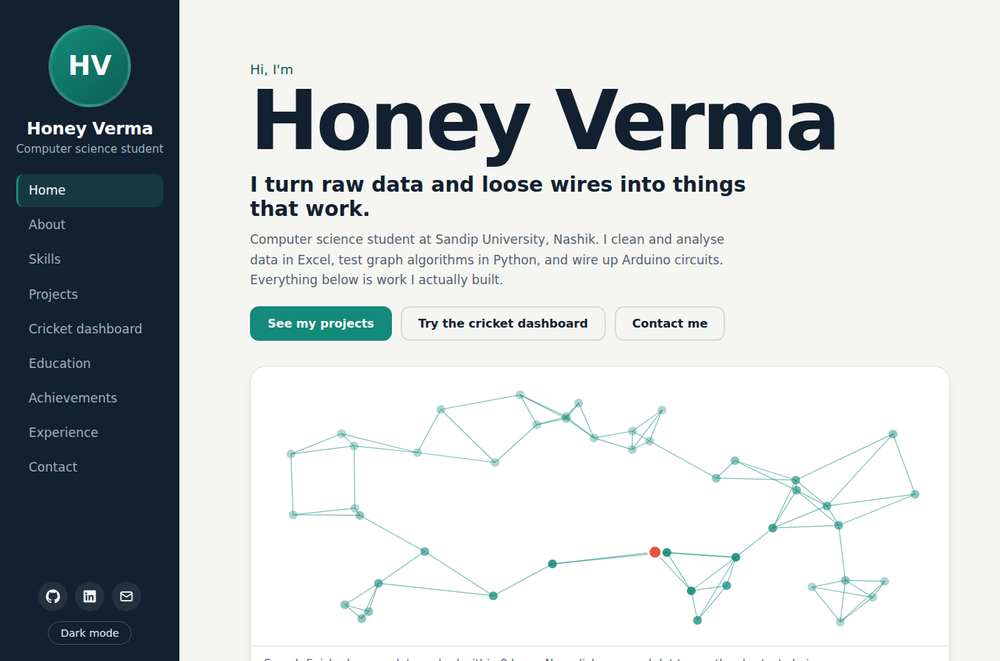
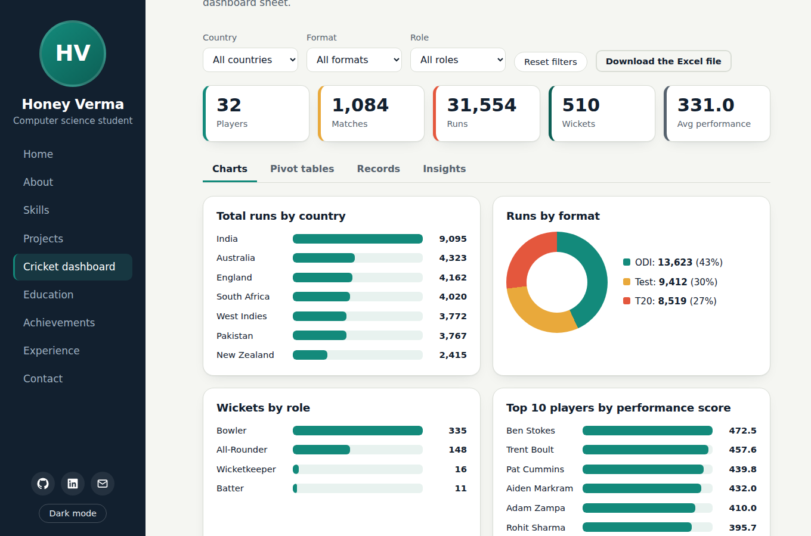
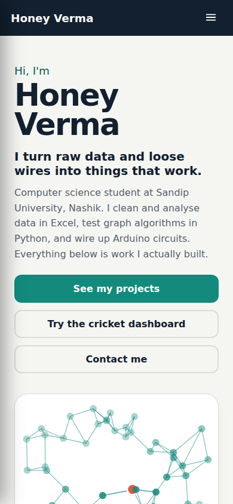

# Honey Verma | Personal Portfolio Website

A responsive portfolio that shows my real work: a **live cricket analytics dashboard** rebuilt from my Excel workbook, a **BFS Social Network Connection Finder** report, an **Arduino automatic room light** mini project, and my certificates.

**Live website:** https://YOUR-PROJECT.vercel.app  *(replace after deploying)*
**GitHub repository:** https://github.com/honeyverma5280-ship-it/YOUR-REPO-NAME  *(replace with your repo name)*

## Features
- Sidebar layout that turns into a menu on phones and tablets
- Light and dark theme (remembers your choice)
- Clickable BFS network on the home page: click a dot to watch breadth-first search spread, click a second dot to see the shortest chain
- Live cricket dashboard: Country, Format and Role filters, KPI cards, charts, six pivot tables, searchable and sortable records, insights
- Project filter (Data, Python, Electronics, Web)
- Certificate gallery with a full-size viewer
- Contact form that opens the visitor's email app
- Keyboard accessible, respects reduced-motion settings, no horizontal scrolling on mobile

## Technologies used
HTML5, CSS3 (custom properties, grid, flexbox), vanilla JavaScript, Canvas API, Google Fonts. No frameworks and no build step.

## Project structure
```
index.html
assets/
  css/style.css
  js/main.js          site behaviour + BFS hero
  js/dashboard.js     cricket dashboard
  data/cricket.js     96 cleaned records exported from the Excel workbook
  img/                certificates and project images
  files/              Excel workbook, BFS report (PDF), Arduino report (DOCX)
screenshots/
```

## How to run locally
1. Download or clone the repository.
2. Open `index.html` in a browser. Or run `python -m http.server 8000` in the folder and visit http://localhost:8000.

## Deploy on Vercel
1. Push this folder to a GitHub repository.
2. On vercel.com choose **Add New > Project** and import the repository.
3. Framework preset: **Other**. Leave build command and output directory empty.
4. Click **Deploy**, then paste the live URL at the top of this README.

## Screenshots
| Home | Cricket dashboard | Mobile |
|---|---|---|
|  |  |  |

## Author
**Honey Verma**, Computer Science, School of CSE, Sandip University, Nashik
- Email: honeyverma5280@gmail.com
- LinkedIn: https://www.linkedin.com/in/honey-verma-b00669422
- GitHub: https://github.com/honeyverma5280-ship-it
